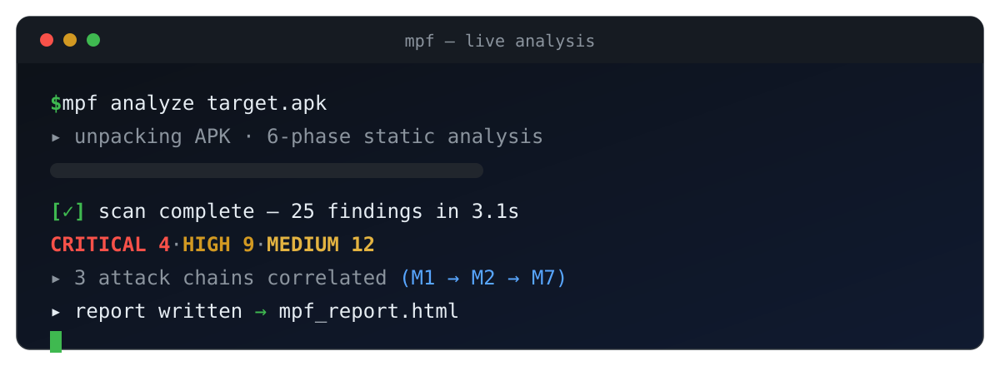
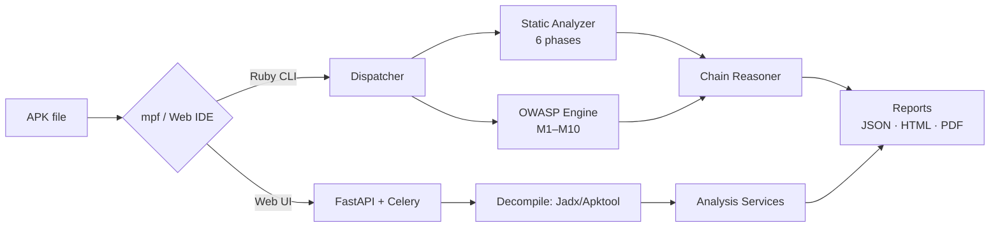

<p align="center">
  
</p>

<h1 align="center">MPF — Mobile Penetration Testing Framework</h1>

<p align="center">
  <b>End-to-end Android security platform:</b> a Metasploit-style Ruby CLI with 24 modules <b>+</b> a full-stack React reverse-engineering IDE. OWASP Mobile Top 10 covered, reports in JSON / HTML / PDF.
</p>

<p align="center">
  
  
  
  
</p>

> ⚠️ **Educational & authorised research use only.** Never test an app you don't own or lack explicit written permission to assess.

---

## ✨ What you get

**🖥️ Web IDE (full-stack platform)** — decompile APKs and explore them like an IDE: interactive file tree, Monaco code editor, manifest & permission risk analysis, certificate inspector, domain/Firebase intelligence, malware lookup, SBOM, and compliance dashboards.

**⌨️ CLI engine (`mpf/`, Ruby)** — a Metasploit-inspired interactive shell: load 24 exploit / payload / auxiliary modules, run a 6-phase static analysis pipeline, get attack-chain correlation and graded OWASP scoring, and export polished reports.

**🛡️ Honest findings** — real APK scans are clearly separated from simulated ones: simulations are loudly warned about and tagged, never silently mixed into results.

---

## 🏗️ Architecture



---

## 🚀 Quick start

### Web platform (Docker)

```bash
git clone https://github.com/dozikim/mpf.git
cd mpf
./install.sh     # dependencies + migrations
./start.sh       # postgres, redis, api, worker, frontend
```

- Web IDE → http://localhost:5173
- API → http://localhost:8000 · Swagger → http://localhost:8000/docs

### CLI (Ruby)

```bash
cd mpf
ruby mpf.rb

mpf > analyze /path/to/target.apk     # full 6-phase scan + OWASP scoring
mpf > use exploits/android/sql_injection
mpf exploit(sql_injection) > set TARGET /path/to/target.apk
mpf exploit(sql_injection) > run
mpf > report generate                 # JSON + HTML compliance reports
```

**Commands:** `use`, `set`, `show`, `run`, `analyze`, `report generate`, `search`, `info`, `back`, `help`, `exit`

---

## 📦 Module inventory (24)

| Type | Count | Highlights |
|------|-------|------------|
| Exploits | 9 | SQLi, WebView RCE, IPC bypass, intent hijacking, deeplink injection, broadcast receiver, fragment injection, clipboard hijack, tapjacking |
| Payloads | 13 | data exfiltration, reverse shell, keylogger, SMS interceptor, credential stealer, persistence agent, … |
| Auxiliary | 2 | APK info scanner, permission analyzer |

**OWASP Mobile Top 10: 100% covered (M1–M10)** — every finding is mapped, severity-weighted, and rolled into an overall grade.

---

## 📸 Screenshots

_Add UI screenshots here (e.g. `docs/assets/ui-overview.png`) once captured._

---

## 🧰 Tech stack

| Layer | Tech |
|-------|------|
| CLI | Ruby 2.7+, Readline, REXML, rubyzip |
| Backend | FastAPI · Celery + Redis · PostgreSQL/SQLite · SQLAlchemy + Alembic |
| Frontend | React 18 · TypeScript · Vite · Monaco Editor · TanStack Query |
| Decompile | Jadx · Apktool |
| Deploy | Docker Compose · Render |

---

## 🤝 Contributing

PRs welcome — especially new detection rules (`mpf/engines/`), modules (`mpf/modules/`), and UI pages. Run `ruby -c` on Ruby changes and `npm run build` in `frontend/` before submitting.

## 📄 License

Educational and research use only — see [LICENSE](mpf/LICENSE).
